<a href="https://shehab20089.github.io/#gh-light-mode-only"></a><a href="https://shehab20089.github.io/#gh-dark-mode-only"></a>

<p align="center">
  <a href="https://shehab20089.github.io/"></a>
  <a href="https://www.linkedin.com/in/shehab-mohsen-6ba984168/"></a>
  <a href="https://shehab20089.itch.io/the-last-abbasid"></a>
</p>

<br>


I'm a senior full-stack engineer with a frontend-first background: **6+ years** building web products across fintech, SaaS, fulfillment, e-commerce and creator platforms, and leading frontend teams at **BitBang**. I take features from the database and API to the UI, set frontend foundations, review code and mentor engineers.

AI is part of how I build and what I build. I direct coding agents (Claude Code, Codex) while owning the architecture and the review, I ship LLM-backed features, and I built the MCP server that lets SparkFlow hand tickets to AI agents.

```ts
const shehab = {
  role: "Senior Full-Stack Engineer & Frontend Lead",
  basedIn: "Cairo, Egypt · remote, UTC+2",
  frontend: ["React", "TypeScript", "Next.js", "Vue", "Tailwind"],
  backend: ["Node.js", "NestJS", "C# / .NET", "PostgreSQL", "Redis"],
  ships: ["payments & invoicing", "real-time features", "multi-tenant admin", "Arabic/English RTL"],
  buildsWith: ["Claude Code", "Codex", "MCP"],
  openTo: ["senior full-stack", "frontend lead", "product engineering"],
};
```

<br>


<a href="https://shehab20089.github.io/?case=sparkflow#work#gh-light-mode-only"></a><a href="https://shehab20089.github.io/?case=sparkflow#work#gh-dark-mode-only"></a>

<p>
  <a href="https://shehab20089.github.io/?case=gopay#work#gh-light-mode-only">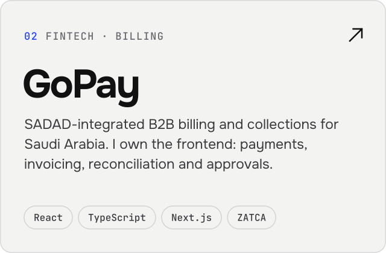</a><a href="https://shehab20089.github.io/?case=gopay#work#gh-dark-mode-only">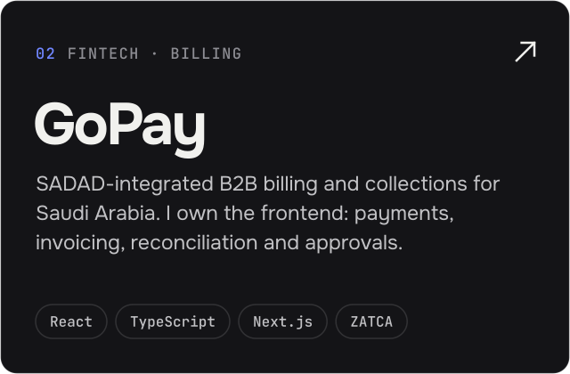</a>
  <a href="https://shehab20089.github.io/?case=amplifidor#work#gh-light-mode-only">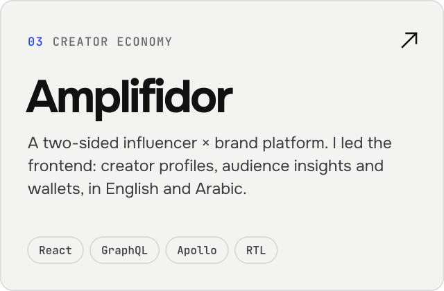</a><a href="https://shehab20089.github.io/?case=amplifidor#work#gh-dark-mode-only">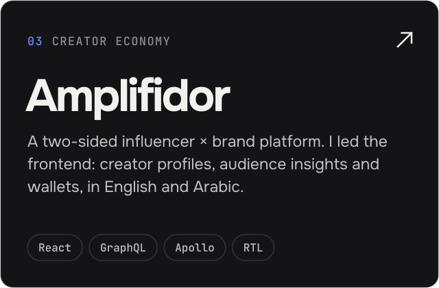</a>
</p>
<p>
  <a href="https://shehab20089.github.io/?case=shamel360#work#gh-light-mode-only">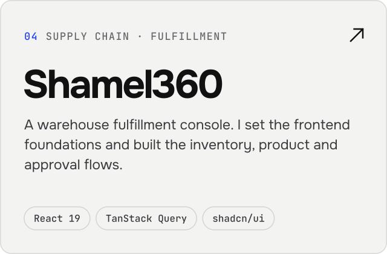</a><a href="https://shehab20089.github.io/?case=shamel360#work#gh-dark-mode-only">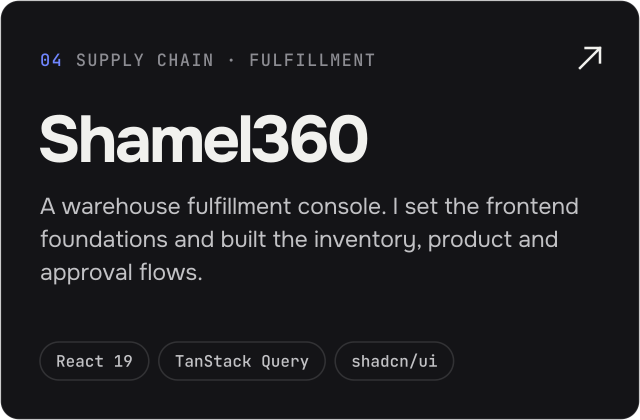</a>
  <a href="https://shehab20089.github.io/?case=fatura#work#gh-light-mode-only">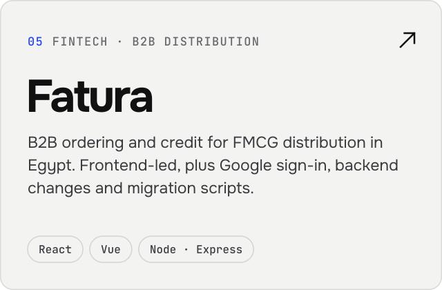</a><a href="https://shehab20089.github.io/?case=fatura#work#gh-dark-mode-only">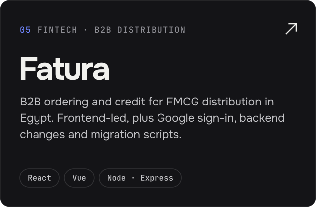</a>
</p>

[**All case studies, including WalaPlus →**](https://shehab20089.github.io/#work)

<br>


**Frontend**<br>
<picture><source media="(prefers-color-scheme: dark)" srcset="https://skillicons.dev/icons?i=ts,js,react,nextjs,vue,tailwind,graphql,vite&amp;theme=dark"></picture>

**Backend & data**<br>
<picture><source media="(prefers-color-scheme: dark)" srcset="https://skillicons.dev/icons?i=nodejs,nestjs,dotnet,cs,postgres,prisma,redis,docker&amp;theme=dark"></picture>

**Tools, AI & games**<br>
<picture><source media="(prefers-color-scheme: dark)" srcset="https://skillicons.dev/icons?i=git,github,githubactions,figma,vercel,godot&amp;theme=dark"></picture>

Also: Claude Code, Codex and MCP servers · BullMQ · TanStack Query · Apollo · ABP / EF Core · Expo · i18n and full RTL

<br>


<a href="https://shehab20089.itch.io/the-last-abbasid">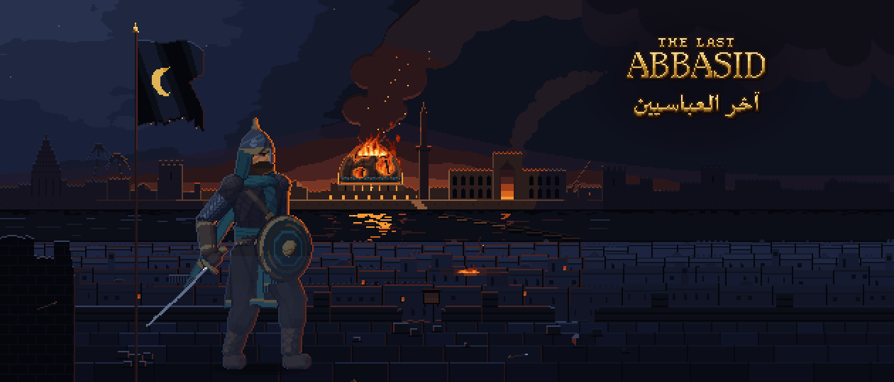</a>

Outside my day job I run **Turath Studios** (تراث), a studio bringing Islamic and Arab history, heritage and faith to people through games, animation and art.

Our first game, **The Last Abbasid**, is a 2D pixel-art action game set in Baghdad in 1258, during the Mongol sack of the city. The Chapter I demo is out on itch.io in English and Arabic, and the full game is planned for Steam. I handle game design, architecture, art direction and release, in Godot 4 with automated gameplay tests. Turath Studios also builds websites for clients.

[**Play the Chapter I demo →**](https://shehab20089.itch.io/the-last-abbasid) · [Turath Studios on LinkedIn](https://www.linkedin.com/company/turath-studios) · [Game source](https://github.com/shehab20089/the-last-abbasid-v2)

<br>


| Repository | What to explore |
| --- | --- |
| [**Portfolio**](https://github.com/shehab20089/shehab20089.github.io) | Next.js site behind [shehab20089.github.io](https://shehab20089.github.io/): content-driven case studies, light/dark theme and generated résumés. |
| [**Awesome UI**](https://github.com/shehab20089/Awesome-UI) | React/TypeScript component library with Tailwind CSS, Storybook and a CLI for adding components. |
| [**Bundle Builder**](https://github.com/shehab20089/bundle-builder-shehab) | Multi-step product configuration with variant quantities, a live review panel and persisted state. |
| [**Vehicle Maintenance Portal**](https://github.com/shehab20089/vehicle-maintenance-portal) | Arabic-first RTL workflow demo with validated forms, role-aware screens, request tracking and an activity timeline. |
| [**Pokémon Browser**](https://github.com/shehab20089/pokemon-browser) | API-driven interface with TanStack Query, pagination and load-more views, lazy loading and error handling. |

<br>

<a href="https://shehab20089.github.io/#gh-light-mode-only">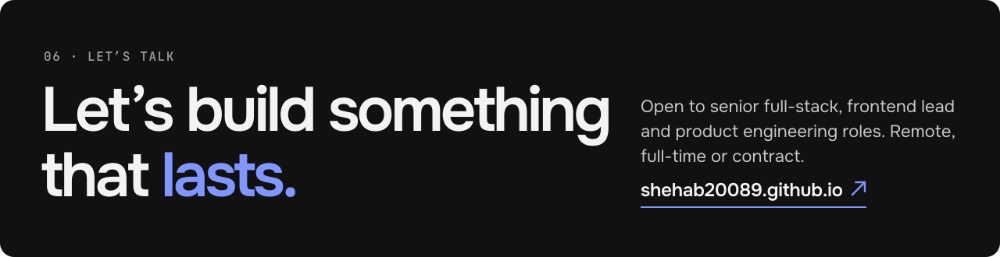</a><a href="https://shehab20089.github.io/#gh-dark-mode-only">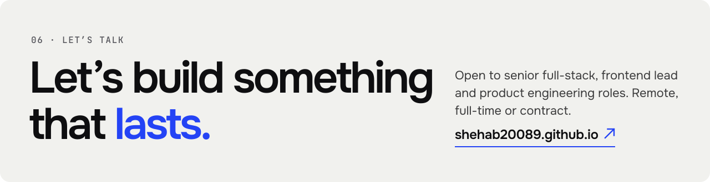</a>

<p align="center">
  <a href="https://shehab20089.github.io/">Portfolio</a> ·
  <a href="https://www.linkedin.com/in/shehab-mohsen-6ba984168/">LinkedIn</a> ·
  <a href="https://shehab20089.itch.io/the-last-abbasid">The Last Abbasid</a>
</p>

<sub>The artwork in this README is generated from <a href="assets/src/generate.mjs"><code>assets/src/generate.mjs</code></a>.</sub>
